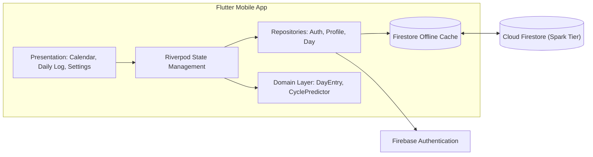

# CycleApps 🌸

A privacy-focused, offline-first menstrual cycle tracking application built with Flutter and Firebase. Designed for personal use and seamless partner collaboration—allowing both partners to log, view, and sync cycle data in real time across multiple devices.

[](LICENSE)
[](https://flutter.dev)
[](https://firebase.google.com)

---

## ✨ Features (MVP)

- 📅 **Interactive Cycle Calendar**: Track period days with customizable flow levels (*Spotting, Light, Medium, Heavy*).
- 🔮 **Cycle & Fertility Predictions**: Automatic estimation of the next cycle, ovulation day, and fertile window based on observed cycle history (standard calendar method).
- 📝 **Comprehensive Daily Logging**:
  - **Physical symptoms**: Cramps, headache, breast tenderness, acne, backache, bloating, nausea.
  - **Mood & Energy**: Happy, calm, sad, anxious, irritable, sensitive; energy levels (*Lemas, Normal, Bertenaga*).
  - **Daily Notes**: Free-form notes up to 2,000 characters.
- 👥 **Partner Collaboration**:
  - Secure 6-character 24-hour invite codes.
  - Shared cycle profile with full editing rights for both partners.
  - Cross-device cloud sync: log on one phone, instantly updated on your partner's phone.
- 📶 **Offline-First Resilience**: Full offline caching powered by Cloud Firestore persistence. Log data without internet; syncs seamlessly once online with a *last-write-wins* resolution per date.
- 🔒 **Zero Third-Party Trackers**: No third-party analytics, advertisements, or telemetry SDKs. Access is strictly controlled via Firestore Security Rules.

---

## 🏗️ Architecture & Tech Stack



- **Framework**: [Flutter](https://flutter.dev) (Dart ≥ 3.5)
- **Backend / BaaS**: [Firebase](https://firebase.google.com) (Package Free/Spark)
  - Firebase Authentication (Email & Password)
  - Cloud Firestore (Multi-region Jakarta `asia-southeast2` with offline persistence)
- **State Management**: [Riverpod 2.x](https://riverpod.dev) (`flutter_riverpod`)
- **Calendar Engine**: [TableCalendar](https://pub.dev/packages/table_calendar)
- **Testing**: `flutter_test`, `fake_cloud_firestore`, `firebase_auth_mocks`, and `@firebase/rules-unit-testing` for Firestore security rules.

---

## 📁 Project Structure

```
CycleApps/
├── docs/                               # Architecture specs and plans
│   └── superpowers/
│       ├── specs/2026-10-15-siklus-design.md
│       └── plans/2026-10-15-siklus-mvp.md
├── lib/
│   ├── main.dart                       # App entry point & Firebase initialization
│   ├── app.dart                        # MaterialApp & AuthGate
│   ├── domain/                         # Pure domain models and cycle algorithms
│   │   ├── date_key.dart               # Date normalization utilities (yyyy-MM-dd)
│   │   ├── day_entry.dart              # Daily log entity & enums
│   │   ├── cycle_predictor.dart        # Pure period detection & prediction
│   │   └── cycle_profile.dart          # Shared profile model
│   ├── data/                           # Repositories interacting with Firebase
│   │   ├── auth_repository.dart        # Authentication wrapper
│   │   ├── profile_repository.dart     # Profiles, member linking & invites
│   │   └── day_repository.dart         # Per-day logging with offline cache
│   ├── state/                          # Riverpod providers
│   └── features/                       # UI screens (Auth, Calendar, Log, Settings)
├── test/                               # Comprehensive unit and widget test suite
├── firestore.rules                     # Declarative access rules for Firestore
└── LICENSE                             # MIT License
```

---

## 🚀 Getting Started

### Prerequisites

1. **Flutter SDK** (v3.24+ / stable)
2. **Node.js** (for Firebase CLI & Security Rules testing)
3. **Firebase Account** (free Spark tier)

### Setup Steps

1. **Clone the repository:**
   ```bash
   git clone https://github.com/m3n54/CycleApps.git
   cd CycleApps
   ```

2. **Install Flutter dependencies:**
   ```bash
   flutter pub get
   ```

3. **Configure Firebase:**
   Install FlutterFire CLI and link your Firebase project:
   ```bash
   dart pub global activate flutterfire_cli
   flutterfire configure --platforms=android --android-package-name=com.menza.siklus
   ```

4. **Run Security Rules Tests (Firestore Emulator):**
   ```bash
   firebase emulators:exec --project demo-siklus --only firestore "npm --prefix firestore-tests test"
   ```

5. **Run the App:**
   ```bash
   flutter run
   ```

---

## 📖 Specifications & Development Plan

Detailed engineering specifications and the test-driven implementation plan are maintained in the repository:
- 📑 [Design Specification](docs/superpowers/specs/2026-10-15-siklus-design.md)
- 📋 [Implementation Plan (TDD)](docs/superpowers/plans/2026-10-15-siklus-mvp.md)

---

## 📄 License

This project is open-source under the [MIT License](LICENSE).
