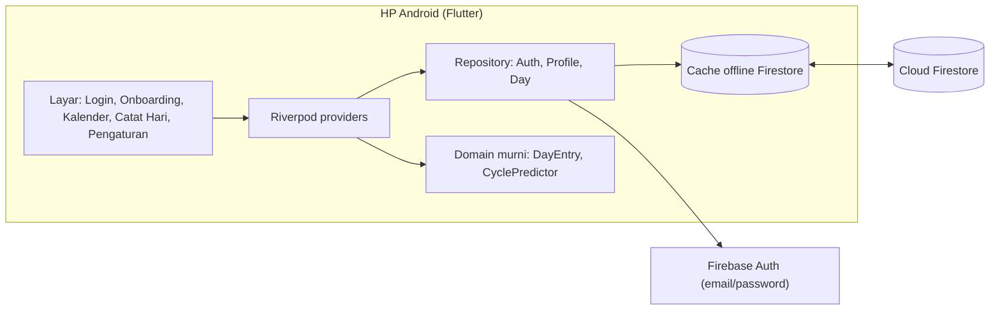

# Siklus — Design Spec (MVP)

Tanggal: 2026-10-15
Status: Draft, menunggu review pengguna

## 1. Tujuan

Aplikasi Android pribadi untuk mencatat siklus menstruasi, dipakai oleh **pengguna dan pasangannya**.
Data tersimpan di akun cloud, sehingga saat ganti HP pengguna cukup login dan datanya kembali.
Seluruh infrastruktur harus **gratis**.

## 2. Keputusan (hasil wawancara)

| # | Keputusan | Sumber |
|---|---|---|
| D1 | Pengguna: saya dan pasangan (bukan rilis publik) | Dijawab |
| D2 | Android saja, dibangun dengan **Flutter** (iOS bisa menyusul) | Dijawab |
| D3 | Satu **profil siklus** bersama; semua anggota bisa mencatat **dan** mengedit | Dijawab |
| D4 | **Offline-first**; konflik diselesaikan dengan *last-write-wins* per tanggal | Dijawab |
| D5 | Backend: **Firebase Auth + Cloud Firestore**, paket Spark (gratis) | Dijawab |
| D6 | Login: **email/password** saja (Google Sign-In = fase berikutnya) | Dijawab |
| D7 | Kategori catatan harian: **gejala fisik** dan **mood & energi** | Dijawab |

## 3. Asumsi default (belum dikonfirmasi, mudah diubah)

| # | Asumsi | Alasan |
|---|---|---|
| A1 | Fitur MVP = kalender haid, intensitas aliran, prediksi haid berikutnya, prediksi masa subur/ovulasi, catatan bebas per hari, undang pasangan via kode | Set rekomendasi; inti yang sudah berguna untuk 2 orang |
| A2 | Di luar MVP: pengingat, statistik/grafik, kontrasepsi, kunci PIN, ekspor, edukasi, mode hamil, keputihan, tidur | YAGNI; masuk fase berikutnya |
| A3 | Privasi: tanpa enkripsi end-to-end di MVP; data dilindungi Firestore Security Rules + enkripsi at-rest Google; **tanpa SDK analytics/iklan** | E2E membuat berbagi data dengan pasangan & pemulihan akun jauh lebih rumit |
| A4 | Distribusi: APK release di-*sideload* ke 2 HP (opsional Firebase App Distribution, gratis) | Tidak perlu Play Store untuk 2 pengguna |
| A5 | REA hanya untuk riset UX opsional (lihat §9), tidak memblokir implementasi | Fitur MVP sudah jelas tanpa membedah aplikasi lain |

## 4. Referensi aplikasi

- **Euki** (open-source): model *privacy-first*, prediksi berbasis kalender sederhana. Baca kode sumbernya langsung.
- **Clue**: taksonomi gejala & alur pencatatan harian yang rapi.
- **Flo**: hanya inspirasi; terlalu luas, dan riwayat berbagi data kesehatan adalah contoh yang dihindari.

Tidak menyalin kode, aset, atau merek aplikasi proprietary.

## 5. Arsitektur



- Prediksi dihitung **di HP** (fungsi murni), bukan di server → tidak perlu Cloud Functions (yang butuh paket berbayar).
- Sinkronisasi & offline = fitur bawaan Firestore (persistence aktif).
- Tulis data **tidak di-await** di UI, karena Future Firestore baru selesai setelah tersinkron ke server; saat offline, UI tetap responsif.

## 6. Model data Firestore

```
users/{uid}
  activeProfileId: string

profiles/{profileId}
  ownerUid: string
  memberUids: string[]          // maks 5
  name: string
  defaultCycleLength: int       // 28
  defaultPeriodLength: int      // 5
  createdAt: timestamp
  joinedWithCode?: string       // diisi saat anggota bergabung

profiles/{profileId}/days/{yyyy-MM-dd}
  date: string                  // == id dokumen
  flow: null|"spotting"|"light"|"medium"|"heavy"
  symptoms: string[]            // cramps, headache, breastTenderness, acne, backache, bloating, nausea
  moods: string[]               // happy, calm, sad, anxious, irritable, sensitive
  energy: null|"low"|"medium"|"high"
  note: string                  // maks 2000 karakter
  updatedBy: uid
  updatedAt: server timestamp

invites/{CODE}                  // 6 karakter, alfabet tanpa 0/O/1/I
  profileId: string
  createdBy: uid
  expiresAt: timestamp          // dibuat + 24 jam
```

*Last-write-wins*: satu dokumen per tanggal, ditulis utuh dengan `set()` → versi terakhir yang sampai di server menang.
Hari yang dikosongkan sepenuhnya → dokumennya dihapus.

## 7. Aturan prediksi (metode kalender)

1. **Hari haid** = hari dengan `flow` ∈ {light, medium, heavy}. *Spotting* tidak dihitung.
2. **Periode** = rangkaian hari haid; jeda ≤ 1 hari kosong tetap dianggap periode yang sama.
3. **Panjang siklus** = selisih hari antar awal periode berurutan; hanya nilai 15–60 hari yang dipakai; ambil maks 6 siklus terakhir; rata-rata dibulatkan. Tanpa data → `defaultCycleLength` (28).
4. **Panjang haid** = rata-rata durasi maks 6 periode terakhir. Tanpa data → `defaultPeriodLength` (5).
5. **Haid berikutnya** = awal periode terakhir + rata-rata siklus. Jika sudah lewat, tampilkan "terlambat N hari" (tidak digeser maju).
6. **Ovulasi** = haid berikutnya − 14 hari. **Masa subur** = ovulasi − 5 s/d ovulasi + 1.
7. Disclaimer di aplikasi: *prediksi hanya perkiraan, bukan alat kontrasepsi atau diagnosis medis.*

## 8. Keamanan (Firestore Security Rules)

- `users/{uid}`: hanya pemiliknya.
- `profiles/{id}`: baca/ubah nama hanya anggota; membuat profil hanya dengan diri sendiri sebagai anggota tunggal.
- Bergabung: user hanya boleh menambahkan **dirinya sendiri** ke `memberUids`, dan hanya dengan kode undangan yang valid, belum kedaluwarsa, dan menunjuk ke profil itu.
- `days`: baca/tulis/hapus hanya anggota; field dibatasi; `updatedBy` wajib = user yang login; `date` wajib = id dokumen.
- `invites`: siapa pun yang login boleh `get` satu kode (tidak boleh `list`); hanya anggota profil yang boleh membuat.
- Rules diuji otomatis dengan Firestore Emulator.

## 9. Riset opsional dengan REA

- Euki: baca source di GitHub (REA tidak diperlukan untuk kode sumber terbuka).
- Clue: jika ingin membedah taksonomi gejala/alur UX dari APK, REA butuh **JADX headless + JDK** (`REA_JADX_MCP_JAR`). Hasil riset hanya jadi inspirasi desain.

## 10. Di luar cakupan MVP

Google Sign-In, keluar dari profil/hapus anggota, edit default siklus, pengingat, grafik, ekspor, iOS, rilis Play Store.

## 11. Kriteria sukses

1. Akun A membuat profil dan mencatat haid; prediksi muncul di kalender.
2. Akun B bergabung dengan kode undangan, melihat & mengedit data yang sama.
3. Catatan yang dibuat saat mode pesawat muncul di HP lain setelah online.
4. Login di HP baru memulihkan semua data.
5. Semua unit/widget test dan test Security Rules lulus.
